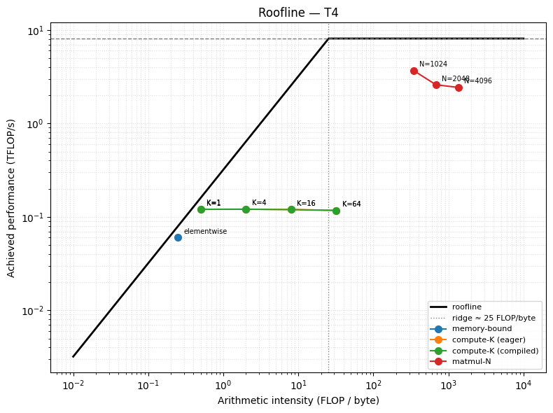
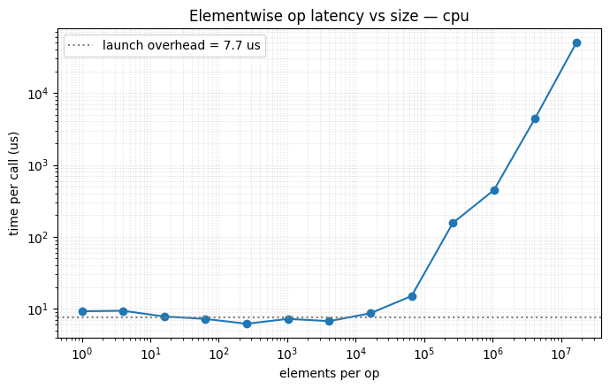

# GPU Perf Lab: From Roofline to CUDA Graphs

**Measuring and optimizing GPU inference from first principles: real kernels placed on the roofline, profiling a naive LLM decode loop and making it 2.9× faster with identical output tokens, and removing kernel-launch overhead with `torch.compile` and CUDA graphs.**

   

## 1. Roofline & arithmetic intensity · [`notebooks/1_roofline.ipynb`](notebooks/1_roofline.ipynb)

We timed kernels with `torch.cuda.Event`, because `time.time()` only measures how fast Python queued the work. Each kernel was then placed on the T4's roofline: 8 TFLOP/s peak, 320 GB/s bandwidth, with the ridge at about 25 FLOP/byte.



- **Elementwise** (AI 0.25) sits on the memory-bound slope at 241 GB/s.
- **Chained elementwise, K ops per element:** the *ideal* AI grows with K, but in eager mode every op makes its own trip to memory, so achieved throughput stays flat. That gap is exactly what kernel fusion buys you. Compiling the bf16 kernels wasn't supported on the T4, so the compiled series falls back to eager.
- **N×N matmul:** about 2N³ FLOPs over about 4N² bytes moved, so AI grows linearly with N. It lands far right in the compute-bound region, at 2–4 TFLOP/s.

## 2. Profile & optimize a decode loop · [`notebooks/2_decode_optimization.ipynb`](notebooks/2_decode_optimization.ipynb)

The starting point was a deliberately slow greedy decode on a tiny Llama: no KV cache, fp32 eager, and a host sync every step. We profiled it with `torch.profiler` and read the Chrome traces in Perfetto.

| Step | ms / generation (128 tokens) |
|---|---|
| Baseline V0 | 526 |
| + KV cache (stop recomputing the whole prefix) | 402 |
| + no `.item()` host sync, no growing `torch.cat` | 376 |
| fp16 weights | 411 (slower, so dropped) |
| **+ `torch.compile`** | **186 (2.88×)** |

The output tokens are identical to the fp32 baseline. **The lesson:** decode is memory-bound per kernel, but on a tiny model at batch size 1 the kernels are so short that *launch overhead* dominates. That's why the compiler, which removes launches, beat the KV cache, which removes memory traffic.

## 3. `torch.compile` & CUDA graphs · [`notebooks/3_compile_and_cuda_graphs.ipynb`](notebooks/3_compile_and_cuda_graphs.ipynb)

- **Cost of one launch:** we swept one elementwise op from 1 to 16M elements. Below about 64K elements the time is flat at **~7.7 µs**, which is pure launch overhead.
- **Graph breaks:** a decode step containing `.item()`, an `if` on tensor data, and `print` compiled into 3 graphs with 2 breaks. Rewriting it to stay on the device gave **one graph (`fullgraph=True`) and a 1.8× speedup**.
- **CUDA graphs by hand:** capture a decode step once, then replay it with a single launch. This requires static input and output buffers, fixed shapes, and no host syncs.



> Notebook 3 was run on CPU, so its GPU-only cells (manual CUDA-graph replay and the 4-way decode benchmark) show `SKIP`. The written answers cover the expected behaviour.

## Run it

```bash
pip install -r requirements.txt
jupyter notebook notebooks/
```

A CUDA GPU is needed for meaningful numbers; the notebooks cut down their sizes automatically on CPU. Profiler traces are written to `results/`. Open them at [ui.perfetto.dev](https://ui.perfetto.dev).

## Context

This was homework 1 of the GPU performance module in **Nebius Academy: AI Performance Engineering** ("From Roofline to CUDA Graphs"). The task formulations are kept inline in each notebook.

## Authors

**Nathanael Bloch** · **Tomer Porat**
